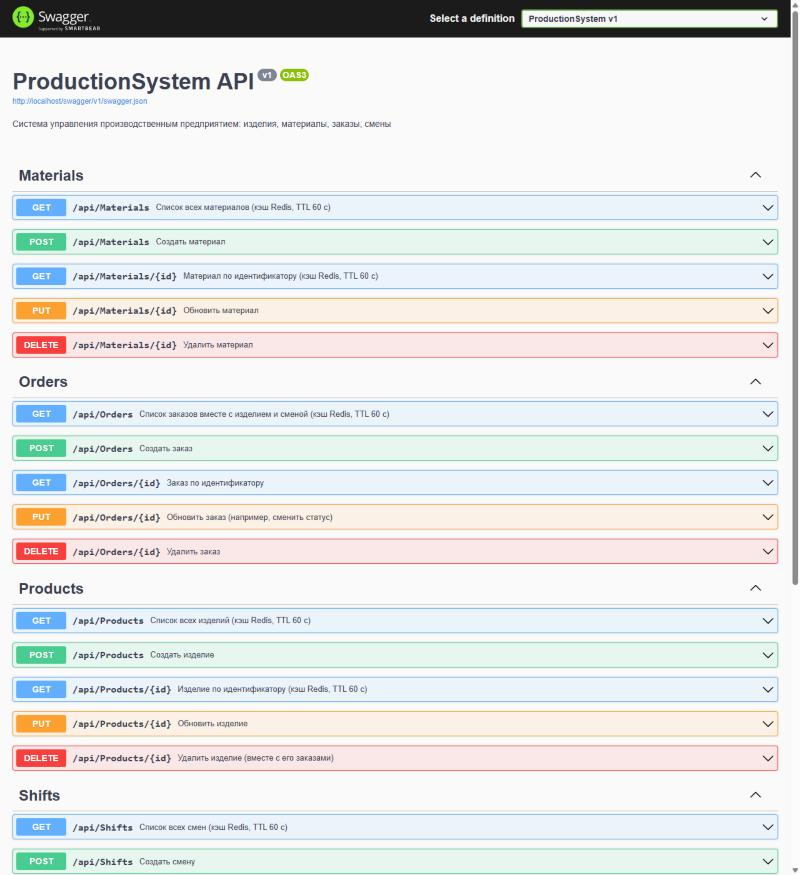
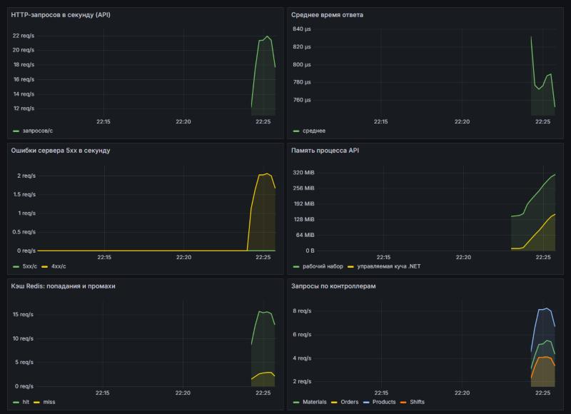
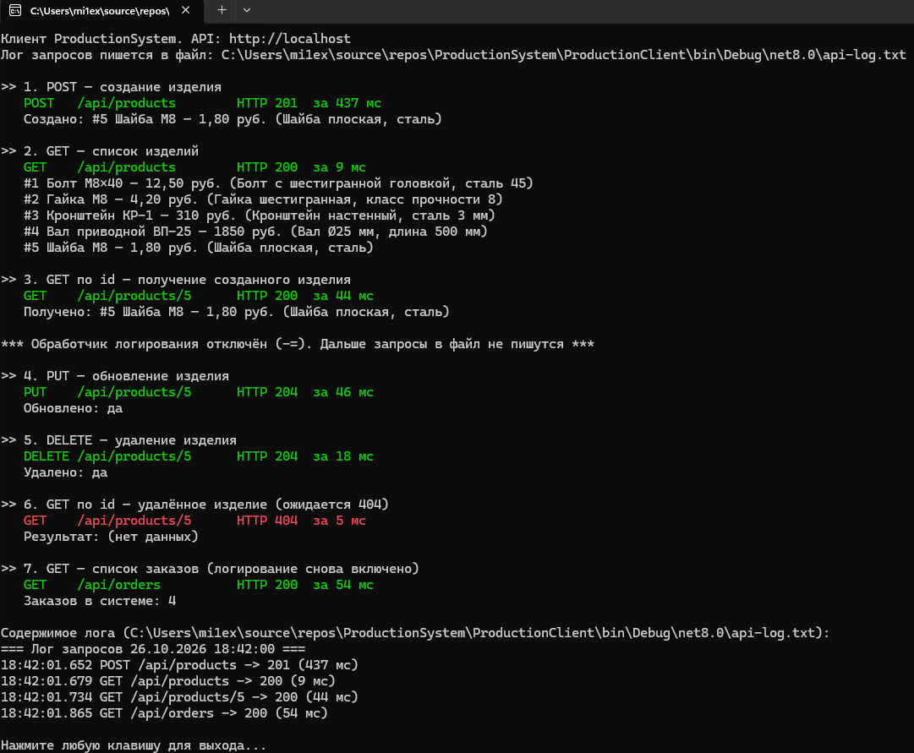
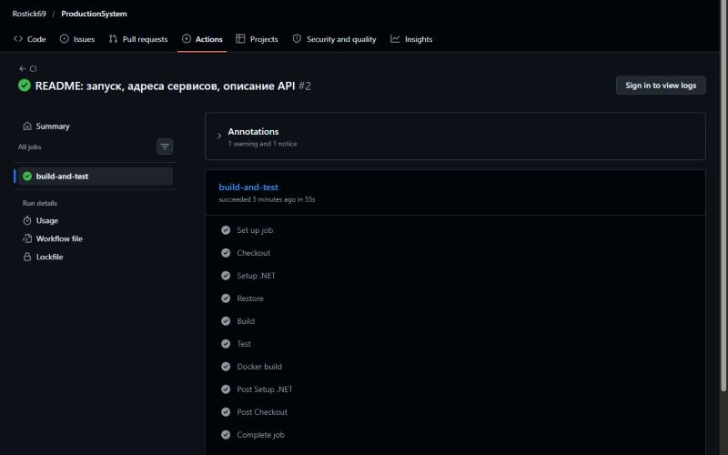

# Система управления производственным предприятием

Лабораторная работа №3 по дисциплине «Системное программное обеспечение»  
Вариант 17 — система управления производственным предприятием: изделия, материалы, заказы, смены 🚀

## Что умеет система

- **REST API (ASP.NET Core 8)** — CRUD для изделий, материалов, смен и заказов, документация в Swagger UI
- **PostgreSQL** — данные хранятся в базе, миграции EF Core и тестовые данные применяются автоматически при запуске
- **Redis** — кэширование GET-запросов (TTL 60 секунд), кэш сбрасывается при изменении данных
- **Nginx** — обратный прокси, единая точка входа на порту 80
- **Prometheus + Grafana** — метрики API и готовый дашборд из 6 панелей (подключается автоматически)
- **GitHub Actions** — сборка, тесты xUnit и сборка Docker-образа при каждом push
- **Консольный C#-клиент** — работа с API через делегаты и события

## Как запустить

Нужен Docker Desktop.

```bash
git clone https://github.com/Rostick69/ProductionSystem.git
cd ProductionSystem
docker compose up -d --build
```

| Сервис | Адрес | Примечание |
|--------|-------|------------|
| Swagger UI | http://localhost/swagger | через Nginx |
| API | http://localhost/api/products | через Nginx |
| Grafana | http://localhost:3000 | логин `admin`, пароль `admin`, дашборд «ProductionSystem — мониторинг API» |
| Prometheus | http://localhost:9090 | Status → Targets: цель `productionsystem` в состоянии UP |
| PostgreSQL | localhost:5432 | база `productiondb`, пользователь/пароль `postgres` |

Клиент запускается после старта системы:

```bash
dotnet run --project ProductionClient
```

Остановить систему: `docker compose down` (с удалением данных: `docker compose down -v`).

## Скриншоты

| Swagger UI | Дашборд Grafana |
|------|------|
|  |  |

| Консольный клиент | GitHub Actions |
|------|------|
|  |  |

## Сущности

| Сущность | Поля | Связи |
|----------|------|-------|
| Product (изделие) | Id, Name, Description, Price | — |
| Material (материал) | Id, Name, Unit, Quantity | — |
| Shift (смена) | Id, Name, StartTime, EndTime, Supervisor | — |
| Order (заказ) | Id, ProductId, ShiftId, Quantity, Status, CreatedAt | Order → Product (обязательно, каскадное удаление), Order → Shift (необязательно, при удалении смены ShiftId = NULL) |

## Эндпоинты

Для каждой сущности (`products`, `materials`, `shifts`, `orders`):

| Метод | Адрес | Коды ответа |
|-------|-------|-------------|
| GET | /api/{entity} | 200 |
| GET | /api/{entity}/{id} | 200, 404 |
| POST | /api/{entity} | 201, 400 |
| PUT | /api/{entity}/{id} | 204, 400, 404 |
| DELETE | /api/{entity}/{id} | 204, 404 |

Кэш Redis: списки всех сущностей и записи по id для изделий, материалов и смен.

## Структура

```
ProductionSystem/            ASP.NET Core Web API
  Controllers/               контроллеры CRUD
  Data/                      AppDbContext, применение миграций и тестовые данные (DbSeeder)
  Models/                    Product, Material, Shift, Order
  Services/CacheService.cs   работа с Redis + метрика попаданий в кэш
  Migrations/                миграции EF Core
  Dockerfile                 многоступенчатая сборка образа
ProductionSystem.Tests/      тесты xUnit (база и кэш в памяти)
ProductionClient/            консольный клиент: ApiService, собственные делегаты, Action/Func
grafana/                     источник данных и дашборд Grafana (provisioning)
docker-compose.yml           все 6 сервисов
nginx.conf, prometheus.yml   конфигурация прокси и сбора метрик
.github/workflows/ci.yml     пайплайн GitHub Actions
```
## Отчёт

[docs/Отчёт_лаба3.docx](docs/Отчёт_лаба3.docx)

